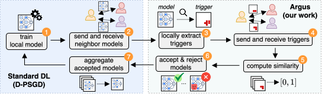

# ARGUS - Backdoor detection in decentralized learning



This repository includes the code for our paper titled **"Your Neighbors Know: Leveraging Local Neighborhoods for Backdoor Detection in Decentralized Learning"**, accepted at **NeurIPS'26**, which you can access [here](https://arxiv.org/abs/2605.19969).

# Installation

This repo makes use of the **DecentralizePy** framework (Dhasade et al., EuroMLSys'23), which is available at <https://github.com/sacs-epfl/decentralizepy>.
The `eval/` and `tutorial/` folders come from DecentralizePy; the experiments of the paper only use `eval/testing.py` and `tutorial/ip.json` from them.
We reproduce the installation procedure below.

* Clone and enter the repository.
* Check that you have `python>=3.11`.

    ```bash
    python3 --version
    ```

* (Optional) Create and activate a virtual environment.

    ```bash
    python3 -m venv [venv-name]
    source [venv-name]/bin/activate
    ```

* Update pip.

    ```bash
    pip3 install --upgrade pip
    ```

* On Mac M1, installing `pyzmq` fails with `pip`. Use [conda](https://conda.io).
* Install decentralizepy for development

    ```bash
    pip3 install --editable ".[dev]"
    ```

## Datasets

* **CIFAR-10 and Tiny ImageNet**: run `download_dataset.sh` after filling the NFS directory and Python paths at the top of the script. Both datasets are downloaded to `eval/data/`.

    ```bash
    ./download_dataset.sh
    ```

# Reproducing the results

We provide scripts in `scripts/` for reproducing the results of the paper, one per dataset and method:

| Dataset | Argus | Baselines |
|---|---|---|
| CIFAR-10 | `run_decentralized_CIFAR10_Argus.sh` | `run_decentralized_CIFAR10_{Nodefense,Oracle,BaDFL,multikrum,P2pcd}.sh` |
| FEMNIST | `run_decentralized_FEMNIST_Argus.sh` | `run_decentralized_FEMNIST_BaDFL.sh` |
| Tiny ImageNet | `run_decentralized_TinyImageNet_Argus.sh` | `run_decentralized_TinyImageNet_BaDFL.sh` |

Before running a script, set `NFS_DIR` (absolute path to the directory containing this repository) and `env_python` (Python executable of your environment) at its top.
Each script copies the code (without `eval/data/`) to `$HOME/ARGUS`, runs nodes as processes on a single machine, and writes logs and results to `$NFS_DIR/eval/data/<date>-<dataset>/machine0/`.

For example, to run Argus on CIFAR-10, use:

```bash
cd scripts/
./run_decentralized_CIFAR10_Argus.sh
```

As another example, this runs BaDFL on FEMNIST:

```bash
cd scripts/
./run_decentralized_FEMNIST_BaDFL.sh
```
## Outputs

Each node `<rank>` writes the following files to the run's `machine0/` folder:

* `<rank>.log`: the log of the node.
* `<rank>_results.json`: metrics indexed by round, including `test_acc` (clean accuracy), `backdoor_asr` (attack success rate) and the defense counters `defense_rejected` and `defense_accepted`.
* `<rank>_train_loss.png`: the training loss curve.
* `detected_pattern_iter<round>_at<rank>_from_<neighbor>_target<label>.pt`: the triggers reverse-engineered by the local detection of Argus.

The configuration file and graph of the run are copied to the same folder.

## Additional parameters

### General parameters

To change the seed, modify the `random_seed` parameter in `scripts/configuration_files/<your_configuration_file>`. All configuration files default to 1; the seeds considered in the paper were 1, 2 and 3.

For CIFAR-10, you can change the heterogeneity by setting `partition_niid` to `False` (iid setting) or to `dirichlet` (in which case you can vary `alpha`: 0.5 and 0.25 for the paper's configurations).

### Backdoor attack and defense parameters

The id of malicious nodes is controlled by the `malicious_ds_ids` config parameter. It should be a list (possibly empty). The trigger itself can be changed by varying `trigger_position` and `trigger_size`, as well as `target_label`. The available patterns/positions are listed in the comments of the configuration files, and `plot_trigger_types.py` draws them.

Other hyperparameters linked to the local detection and the collaborative steps are available in the respective configuration files and should be self-explanatory.
`compute_sim_threshold.py --dataset {cifar10,femnist,tinyimagenet}` prints statistics of the SSIM score between pairs of random smooth triggers, as a reference for setting `trigger_similarity_threshold`.

### Changing the topology

The topologies considered in the paper are all located in `scripts/topologies/`. You can use them by replacing the `graph` parameter in the script by the corresponding path
New topologies can be generated with `generate_graph.py` (see the docstring at the top of the file for its usage).

# Citation

If you are using the code from this repository, please consider citing our paper:

```bibtex
@inproceedings{biswas2026argus,
  title     = {Your Neighbors Know: Leveraging Local Neighborhoods for Backdoor Detection in Decentralized Learning},
  author    = {Biswas, Sayan and Boutet, Antoine and Frey, Davide and Gaudel, Romaric and Guerraoui, Rachid and Jacovella, Maxime and Kermarrec, Anne-Marie and Ler{\'e}v{\'e}rend, Dimitri and Ta{\"\i}ani, Fran{\c{c}}ois and de Vos, Martijn},
  booktitle = {Advances in Neural Information Processing Systems (NeurIPS)},
  year      = {2026},
  url       = {https://arxiv.org/abs/2605.19969}
}
```
